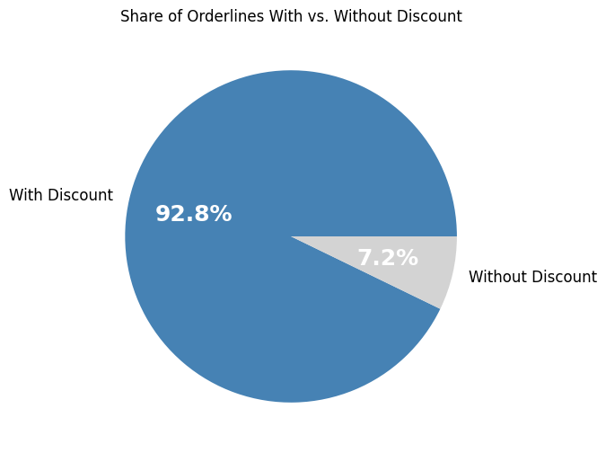
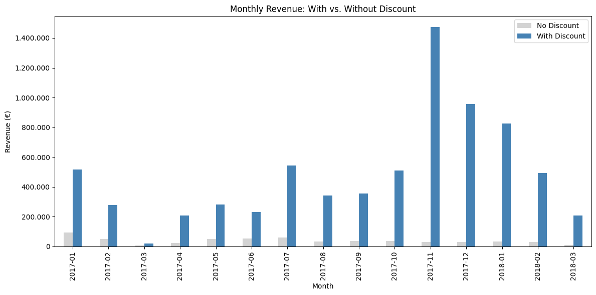
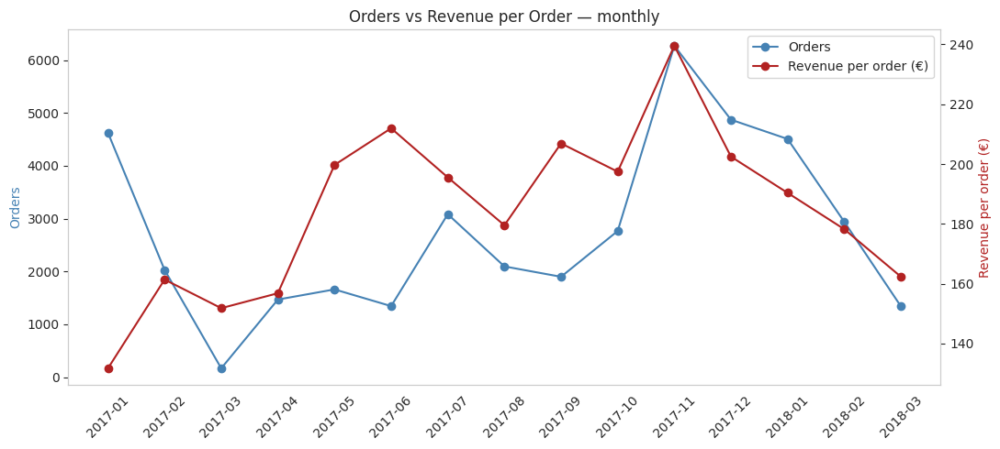
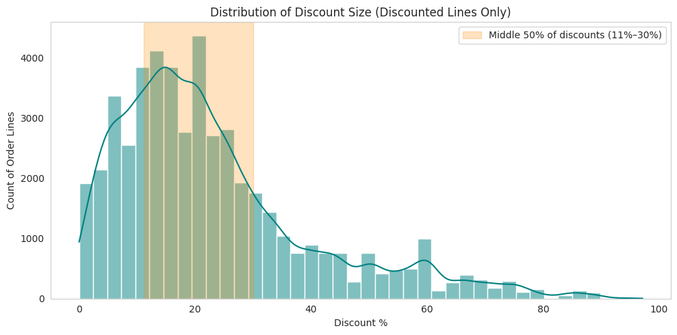
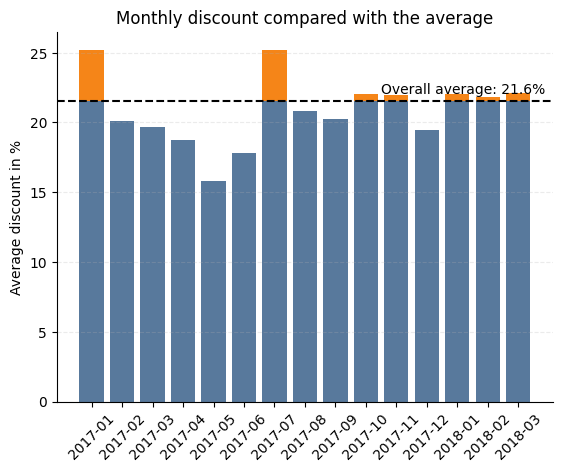
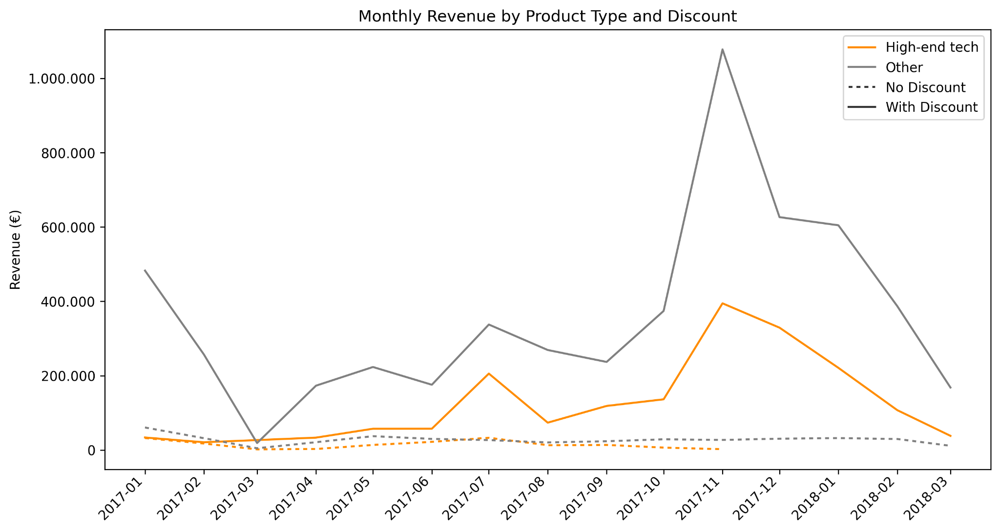
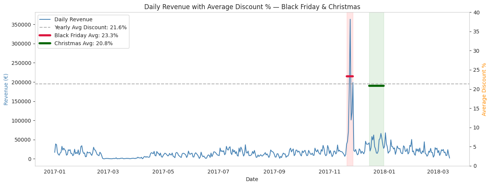

# Eniac's Discount Strategy Analysis

## Project Overview

Eniac, a European e-commerce company specialising in tech products, is debating whether discounting its products is beneficial for the business. The Marketing Team believes discounts drive customer acquisition, satisfaction, and retention. The Board is concerned: a recent quarter showed an increase in orders placed alongside a decrease in total revenue, and prefers Eniac to compete in the quality segment rather than on price.

This project analyses ~2 years of Eniac's internal order and product data to determine whether discounting is actually hurting revenue, how large and how frequent discounts really are, and how seasonality and product category affect the picture. The raw data was corrupted on arrival, so a full data cleaning and quality assessment process was required before any analysis could begin.

---

## Dataset & Sources

- **Source:** Eniac's internal order management database (provided as part of the WBS Coding School case study)
- **Time period:** ~January 2017 – March 2018
- **Files:** `orders.csv`, `orderlines.csv`, `products.csv`, `brands.csv`
- **Data quality:** the raw data was corrupted — missing values, wrong datatypes, duplicate rows, and inconsistent encodings — requiring a full cleaning and quality assessment pass before analysis

---

## Project Workflow

1. **Data Cleaning** (`01_data_cleaning.ipynb`) — resolving missing values, wrong datatypes, duplicate rows, and inconsistent encodings in the raw data.
2. **Quality Assessment** (`02_quality_assessment.ipynb`) — validating the cleaned data and documenting what could and couldn't be fully trusted.
3. **Category Creation** (`03_category_creation.ipynb`) — building a human-readable product category taxonomy, since none existed in the raw data.
4. **Data Analysis** (`04_data_analysis_part1.ipynb`, `05_data_analysis_part2.ipynb`) — analysing discount prevalence, revenue impact, seasonality, and category performance.

---

## Key Findings & Results

### Discounting Is the Norm

92.8% of order lines were sold at a discount — discounting is standard practice at Eniac, not an occasional promotion.



Revenue tells the same story: discounted products generate far more monthly revenue than full-price products, every single month of the period.



### No Revenue Was Lost to Discounting

Orders and revenue per order move together across the full period — there is no sign of the "more orders, less revenue" pattern the Board flagged in one quarter. Both peak sharply in November 2017 (Black Friday) and decline together afterwards.



### Discounts Are Moderate, Not Aggressive

The middle 50% of discounts fall between 11% and 30%, peaking around 15–20%. Steep discounts above 60% are rare.



The overall average discount across the whole period is 21.6%, and monthly averages stay close to that line all year — there's no aggressive escalation over time.



### High-End Tech Underperforms on Volume

High-end tech (desktops, laptops, smartphones, iPads, iPods) earns more revenue when discounted, the same pattern as the rest of the catalogue — but it still contributes far less total revenue than Eniac's other products. It is not yet the company's revenue driver, despite being the strategic "quality segment" focus.



### Seasonality Drives Sales, Not Discount Depth

Revenue spikes sharply around Black Friday and rises again around Christmas — but the average discount during these peaks (23.3% for Black Friday, 20.8% for Christmas) stays close to the yearly average of 21.6%. Customers buy seasonally, not because of deeper price cuts.



---

## Summary

| Stage | Finding |
|---|---|
| Data quality | Corrupted, missing values, duplicates, wrong types |
| Discount prevalence | 92.8% of order lines sold at a discount |
| Discount size | Middle 50% between 11–30%, peaking at 15–20%; yearly average 21.6% |
| Revenue vs. orders | Move together: no revenue lost to discounting |
| Seasonality | Black Friday (23.3%) and Christmas (20.8%) discounts stay close to the yearly average |
| Categories | High-end tech is discount-responsive but still a low share of total revenue |

---

## Recommendation

**Keep discounts around 20%**, the analysis shows no evidence that current discount levels are hurting revenue.

**Increase sales of high-end tech** to position Eniac more firmly in the quality segment.

To support stronger analyses going forward, we recommend improving data collection in three areas:

- **Missing data** — reduce gaps at the source to cut down on cleaning work
- **Customer data** — add customer-level identifiers to enable retention and acquisition analysis
- **Human-readable product categories** — store categories directly instead of reconstructing them from codes

---

## Technologies Used

- **Python**
  - pandas
  - seaborn
- **Jupyter / Google Colab** — analysis environment

---

## Project Structure

```
├── README.md
├── data/
│   ├── raw data/                                original CSV exports (orders, orderlines, products, brands)
|   ├── cleaned data/                            cleaned data,
│   └── quality assessment and categories/       quality-assessed data, category taxonomy
├── notebooks/
│   ├── 01_data_cleaning.ipynb
│   ├── 02_quality_assessment.ipynb
│   ├── 03_category_creation.ipynb
│   ├── 04_data_analysis_part1.ipynb
│   └── 05_data_analysis_part2.ipynb
├── figures/                                    the charts used in the board presentation
└── eniac-discount-strategy-presentation.pptx   final slide deck presented to the Eniac board
```
